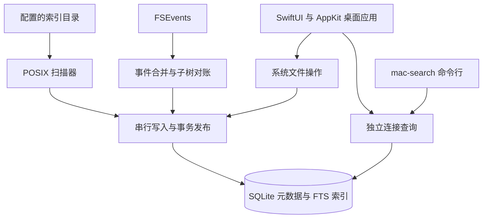

# MacSearch

MacSearch 是一款完全离线的 macOS 原生文件名搜索工具，提供 SwiftUI 桌面应用和 `mac-search` 命令行工具。为指定目录建立 SQLite 索引后，搜索直接查询索引；FSEvents 在后台接收文件变化并增量更新。

**当前桌面版本：1.0.0。** 已完成命令行引擎、增量监听与异常恢复、原生桌面应用三个阶段，支持结果排序、移到系统废纸篓，以及右键复制路径和名称。当前仅索引文件系统元数据，不读取文件正文。

## 功能概览

| 功能 | 当前支持 |
| --- | --- |
| 索引范围 | 多个独立根目录，拒绝重复或父子目录重叠 |
| 文件名搜索 | 中文、英文、忽略大小写、字面子串、多关键词 AND |
| 搜索过滤 | 目录范围、多个扩展名、文件／目录类型 |
| 结果排序 | 匹配度，或按名称、所在目录、修改时间、大小升降序 |
| 文件操作 | 打开、在 Finder 中显示、复制路径、复制名称、移到废纸篓 |
| 索引管理 | 添加／移除目录、单目录／全部重建、条目统计和异常状态 |
| 自动更新 | FSEvents、事件合并、子树对账、失败重试和启动校验 |
| 桌面入口 | 菜单栏常驻、全局快捷键、可选登录启动 |
| 命令行 | 目录管理、重建、持续监听、搜索、统计及 JSON 输出 |
| 安装 | 用户目录安装，无需管理员密码，无额外运行时依赖 |

搜索关键词匹配**文件或目录的名称**；完整路径用于结果展示和目录过滤，不会把父目录名作为文件名关键词匹配。

## 安装与更新

### 环境要求

- macOS 13 或更高版本。
- 从源码构建需要 Swift 6 工具链及 macOS SDK，可使用兼容的 Xcode／命令行开发工具。
- 使用系统 SQLite 和系统框架，无第三方 Swift 包、Electron 或 Python 运行时依赖。验证和基准脚本另需 Python 3。

macOS 13 是构建最低目标，目前实际验证环境为本机 Apple Silicon 和系统 SQLite，尚未逐个系统版本及 Intel Mac 验证。

### 桌面应用

在项目目录执行：

```bash
./scripts/publish_app.sh
open "$HOME/Applications/MacSearch.app"
```

安装位置为 `~/Applications/MacSearch.app`，无需管理员密码。脚本构建 release 版本、生成应用图标与 Info.plist、执行签名并安装。更新时先通过菜单或 `Cmd+Q` 完全退出应用，再执行同一脚本；已有索引和目录配置保留。

只构建应用包：

```bash
./scripts/build_app.sh
# 产物：.build/app/MacSearch.app
```

默认使用本机 ad-hoc 签名。分发到其他 Mac 时需要另外处理 Developer ID 签名及公证；可通过环境变量 `MAC_SEARCH_SIGN_IDENTITY` 指定签名身份。

### 命令行工具

```bash
./scripts/publish.sh
mac-search help
```

命令安装到 `~/.local/bin/mac-search`，重复执行即可更新，无需写入 `/usr/local/bin` 或输入管理员密码。如果终端提示找不到命令，将下面一行加入 `~/.zprofile`，再打开新终端：

```bash
export PATH="$HOME/.local/bin:$PATH"
```

也可以直接运行 `~/.local/bin/mac-search`。桌面和命令行分别发布，桌面安装脚本不会自动安装 CLI。

## 桌面使用

### 添加目录与搜索

1. 点击“添加目录”，选择需要搜索的文件夹；已有 CLI 目录配置会自动读取。
2. 等待目录建立或校验索引。启动校验期间可以输入关键词，并查询已有索引。
3. 左侧选择全部目录或某个根目录，顶部选择文件／目录类型，或输入扩展名进行过滤。

多个扩展名用英文逗号分隔，例如 `pdf,docx`。结果默认显示前 100 条，可点击“加载更多结果”逐次加载至 1000 条；底部数量是当前返回条数。需要更多结果时收窄筛选，或使用 CLI 的 `--limit`。

输入采用 120ms 去抖，过期查询会取消，旧响应不会覆盖新结果。底部显示查询耗时；该值不包含输入去抖和完整窗口渲染时间。

### 结果排序

点击“名称”“所在目录”“修改时间”“大小”表头排序，再次点击切换升降序。排序作用于**全部匹配记录后再取前 N 条**，切换筛选或加载更多时继续沿用。点击“恢复匹配度”回到默认排序。

- 名称按忽略大小写后的文本排序；所在目录按完整路径排序。
- 同值时按名称和路径稳定排序，缺失时间或大小始终排在末尾。
- 目录大小显示为“—”，不递归计算目录体积。
- 大范围的时间、大小排序可能比默认匹配度查询更慢。

### 右键菜单与文件操作

在结果行上右键可选择：

| 操作 | 行为 |
| --- | --- |
| 打开 | 使用系统默认应用打开文件或目录 |
| 在 Finder 中显示 | 定位并选中该条目 |
| 复制路径 | 复制完整路径 |
| 复制名称 | 复制完整文件名（包含扩展名）或目录名，不带父目录路径 |
| 移到废纸篓… | 确认后调用系统废纸篓操作，目录会连同内部文件一起移动 |

例如，对 `~/Documents/客户合同.pdf` 执行“复制名称”，得到 `客户合同.pdf`。

删除前会展示完整路径，并在执行时校验文件身份。索引根目录、正在使用的数据库及包含数据库的目录受保护；确认期间文件被替换、访问被拒绝或卷不支持废纸篓时会显示原因，不回退为永久删除。可在 Finder 的废纸篓中恢复已移走的文件。

删除成功且确认原路径不存在后，会在事务中精确清理目标及其后代，并立即从列表移除、重新查询。暂停自动更新时也有效；其他同级目录无法读取不会阻止该次清理。同路径已被重建时改为校验新条目，不设置永久隐藏名单。

**持续监听已就绪时，应用内删除复用原监听流和串行写连接，不停止或重启 FSEvents，也不会因此重新校验所有目录。** 删除成功或失败后恢复可操作状态，期间其他进程的事件继续接收。无法确认父目录或卷身份时保留索引并报错。

### 快捷键与后台运行

| 操作 | 快捷键／入口 |
| --- | --- |
| 显示／隐藏搜索窗口 | `Ctrl+Option+Space`，可在设置中关闭 |
| 聚焦搜索框 | `Cmd+F` |
| 进入列表并选择结果 | 搜索框内按 `↓`，再使用 `↑↓` |
| 打开结果 | 回车、双击或底部“打开” |
| 在 Finder 中显示 | `Cmd+Return` |
| 复制路径 | `Cmd+Shift+C` |
| 复制名称 | 结果右键菜单 |
| 移到废纸篓 | `Cmd+Delete`、右键菜单或底部废纸篓按钮 |
| 添加目录 | `Cmd+O` |
| 设置 | `Cmd+,` |
| 隐藏／关闭窗口 | `Esc`／`Cmd+W`，后台监听继续 |
| 完全退出 | `Cmd+Q` 或菜单栏“退出 MacSearch” |

关闭窗口后，可通过菜单栏图标或全局快捷键重新打开。全局快捷键无需辅助功能授权，注册冲突会在设置中提示，目前不支持自定义组合。

登录启动默认关闭，可在设置中开启“登录时启动 MacSearch”，必要时到系统登录项设置中允许。使用 `SMAppService.mainApp`，不额外安装 LaunchAgent；注册失败时显示原因。

### 目录与索引管理

通过侧栏或菜单栏的“管理索引目录”查看条目数、最近更新时间及错误，执行单目录／全部重建，或移除目录配置。**移除索引目录只清理索引记录，不删除磁盘文件。**

侧栏支持暂停／继续自动更新。暂停期间，外部文件变化不会自动进入索引；新添加目录处于待扫描状态，可手动重建或恢复监听。恢复监听会进行启动校验。

顶部“刷新搜索结果”按钮只重新查询当前索引，不会扫描磁盘；需要校正索引时使用重建或恢复监听。

## 命令行使用

首次使用先添加目录，再重建或直接启动监听：

```bash
mac-search roots add "$HOME/Documents"
mac-search roots list
mac-search index rebuild
mac-search search "report 2026" --ext pdf --limit 100
mac-search stats
```

如桌面应用正在自动更新，先在应用中暂停，再执行需要写入索引的命令。查询、目录列表和统计不需要暂停。

### 命令与参数

| 命令 | 说明 |
| --- | --- |
| `roots add <目录>` | 添加根目录，不自动扫描 |
| `roots list` | 查看 ID、状态、条目数、事件检查点及错误 |
| `roots remove <ID>` | 移除目录配置及其索引 |
| `index rebuild [--root-id <ID>]` | 重建全部或指定根目录 |
| `index watch [--root-id <ID>] [--debounce-ms <毫秒>]` | 先校验，再持续增量更新；合并窗口默认 500ms，范围 100～2000ms |
| `search <关键词> [筛选选项]` | 查询文件名；空字符串可查询无关键词的结果 |
| `stats` | 查看数量、数据库及辅助文件体积、SQLite 和 trigram 状态 |
| `help` | 查看帮助 |

`search` 筛选选项：

| 参数 | 说明 |
| --- | --- |
| `--directory <目录>` | 限定该目录本身及其后代 |
| `--ext pdf,docx` | 多个扩展名，忽略大小写，可带开头的点 |
| `--kind file\|directory\|all` | 条目类型，默认 `all` |
| `--limit <数量>` | 默认 100，范围 1～10000 |

CLI 当前按默认匹配度排序，没有开放桌面四列排序、打开文件、复制或废纸篓操作命令。

```bash
mac-search search 合同 --directory "$HOME/Documents" --kind file
mac-search search "" --ext pdf,docx --limit 500
mac-search index rebuild --root-id 1
mac-search roots remove 1
```

多词搜索须用引号包裹。ID 以 `roots list` 的实际输出为准。

### JSON 与独立数据库

全局选项 `--database <路径>`、`--json` 必须放在命令之前：

```bash
mac-search --json search 报告 --ext pdf
mac-search --json roots list
mac_search_demo_dir="$(mktemp -d)"
mac-search --database "$mac_search_demo_dir/index.sqlite" roots add "$HOME/Documents"
mac-search --database "$mac_search_demo_dir/index.sqlite" index rebuild
mac-search --database "$mac_search_demo_dir/index.sqlite" --json search 合同
```

普通查询返回 JSON 数组或对象；持续监听使用逐行 JSON（JSONL），便于脚本消费：

```bash
# 在一个终端持续运行
mac-search --json index watch --debounce-ms 500

# 在另一个终端查询
mac-search search 合同 --ext pdf
```

CLI 监听是前台进程，按 `Ctrl+C` 或发送 `SIGTERM` 停止并释放写入锁。无需预先重建，`index watch` 会先启动事件流，再校验所选目录。

## 索引、更新与恢复

### 存储与并发

桌面与 CLI 默认共享数据库和目录配置：

```text
~/Library/Application Support/MacSearch/index.sqlite
```

SQLite 使用 WAL，元数据、FTS 触发器和对账检查点通过事务提交。同一数据库只允许一个写入进程，查询使用独立连接，可以与写入并行。查询连接开启 `query_only`；系统 SQLite 在需要时可能创建缺失的 WAL／SHM 辅助文件。

桌面开启自动更新时持有写锁。CLI 要添加／移除目录、重建或监听，需先暂停桌面自动更新。反之，CLI 占用写锁时，桌面保留已有索引搜索并显示占用原因；停止 CLI 后点击“重试自动更新”。桌面自身的目录管理会自动协调停止、执行和恢复监听。

### 扫描范围

扫描使用 POSIX 目录流和 `lstat` 读取名称、路径、大小、修改时间、目录类型等元数据，分批暂存到 SQLite，成功后原子替换相应范围。

- 包含隐藏条目，记录目录和符号链接本身，不跟随符号链接目标。
- 不跨越其他卷；遍历中遇到的应用包作为条目记录，不展开其内部；不计入根目录本身。
- 排除正在使用的索引数据库及其 WAL、SHM、journal 和锁文件。
- 不读取正文，也不主动下载云端文件内容；可访问范围取决于权限和挂载状态。
- 根目录路径会规范化，但不会为了搜索而把真实路径转为小写。

### 哪些操作会校验目录

| 场景 | 当前行为 |
| --- | --- |
| 应用启动、CLI 启动监听、暂停后恢复 | 先启动事件流，再全量校验所选根目录，补处理积累的事件 |
| 外部进程普通新增、修改、删除、移动 | 合并事件，扫描受影响父目录的子树，再原子更新 |
| 应用内移到废纸篓 | 精确清理已确认移走的条目及后代；持续监听时不重启全量校验 |
| 手动重建、桌面目录管理后恢复监听 | 按命令扫描，并按偏好重新启动监听校验 |
| 事件丢失、队列溢出、根路径／挂载变化 | 扩大为相应根目录校验 |
| 权限失败、卷离线或扫描中断 | 保留旧快照并标记状态；监听中失败目录退避重试 |

FSEvents 是范围变化通知，不是严格逐文件日志。普通事件默认合并 500ms，连续事件最多等待 2 秒后开始处理；事件积压和扫描本身会继续影响可见延迟。超过 4096 个待处理目录或收到系统丢包／事件 ID 回绕标记时，退化为根目录校验。

每个失败根目录独立重试，间隔为 5、10、20、40、60 秒，最长 60 秒；新事件也可能提前触发重试。健康目录不会被定期全量重扫。根目录移走后不追随新位置，配置路径恢复且卷身份匹配后再校验。卷 UUID 不符时保留旧索引并报错；不具备 UUID 时使用设备号。

扫描失败或取消不清理该范围的旧记录、不推进其事件检查点。重建按根目录逐个发布，后续目录失败不会撤销已经完成的其他目录。整个遍历不是文件系统快照；监听会补处理扫描期间的变化，稳定后逐步收敛。

`lastScanAt` 是最近成功对账时间，子树对账也会更新；`lastEventID` 是成功处理的事件检查点。其变化不代表整个根目录重新扫描。监听日志中的全局 `ready` 表示启动流程结束，各根目录是否健康仍需查看状态。

当前启动恢复仍采用完整校验，尚未实现只靠历史事件回放的快速启动。大目录的启动／恢复耗时与单次应用内删除耗时应分别看待。

## 搜索规则

| 项目 | 规则 |
| --- | --- |
| 文本规范化 | Unicode 规范化及大小写折叠 |
| 多关键词 | 按空白拆分，所有词都需出现在同一个名称中 |
| 匹配方式 | 字面子串，`%`、`_` 等不作为通配符；不支持正则语法 |
| 默认匹配度 | 完整名称匹配 → 连续前缀匹配 → 其他子串匹配，各组内按名称和路径稳定排序 |
| 路径过滤 | 目录自身及其后代，按路径分隔符检查边界 |
| 搜索索引 | B-tree 与运行时探测的 FTS5 trigram，候选最终按字面规则复核 |

例如，`report 2026` 可命中 `annual_report_2026.pdf`，`合同` 可命中 `客户合同终稿.docx`。不足三个 Unicode 码点的词采用子串查询；系统不支持 trigram 时回退到相同匹配语义，性能可能下降。默认排序的多阶段查询处于同一读事务，避免混用不同索引快照。

## 权限与常见问题

应用未启用 App Sandbox，仍受 macOS TCC 和文件系统权限限制。目录选择器不保证绕过所有隐私限制；使用 CLI 时检查终端的访问权限，使用桌面时检查 MacSearch 的访问权限。登录项注册也依赖安装位置和签名环境。

| 现象 | 检查方式 |
| --- | --- |
| `mac-search: command not found` | 确认已发布 CLI，并把 `~/.local/bin` 加入 PATH |
| 提示另一个进程正在写入 | 暂停桌面自动更新，或停止 CLI 的重建／监听进程 |
| 目录显示等待扫描 | 执行重建，或开启自动更新 |
| “正在校验索引目录”持续较久 | 启动／恢复或目录管理后可能扫描大量文件；外部顶层变化也可能扩大扫描范围 |
| 已有结果可能过期 | 在目录管理中查看具体错误，检查隐私权限、文件权限和卷挂载状态 |
| 只在路径中包含关键词却搜不到 | 关键词只匹配名称，使用目录范围缩小搜索 |
| 刷新搜索后仍有失效结果 | 刷新按钮只重查索引；检查监听状态，必要时重建受影响目录 |
| 再次启动未切换数据库 | 桌面限制为一个实例，先完全退出，再使用新的数据库参数启动 |

## 架构与工程结构



引擎在进程内复用，尚未提供独立常驻服务或 HTTP／Unix Socket／XPC 接口。

选择系统 SQLite 和显式 CLI 参数解析，避免额外运行时及包依赖；trigram 能力在运行时探测，以兼顾系统差异和一致的搜索语义。扫描先暂存再事务发布，以额外磁盘空间换取失败时保留旧快照；数据库版本不兼容时拒绝访问，不尝试覆盖现有数据。

路径由当前用户主目录、项目或脚本所在位置及系统临时目录解析，不绑定开发者机器。发布目标默认是当前用户的 `~/.local/bin` 和 `~/Applications`；系统工具使用 macOS 标准路径。路径处理同时考虑 `/var` 等系统别名及已删除路径，避免同一文件因路径拼写差异而残留索引。

```text
Package.swift
Sources/
  CSQLite/                    # 系统 SQLite C 模块
  MacSearchCore/              # 存储、扫描、查询、监听、对账与精确清理
  MacSearchCLI/               # 命令行参数、输出和信号处理
  MacSearchDesktopKit/        # 后台写入调度、搜索 actor、废纸篓请求校验
  MacSearchDesktop/           # SwiftUI、窗口、菜单栏、快捷键与登录启动
Tests/
  MacSearchCoreTests/         # 查询、排序、扫描、恢复和异常保护
  MacSearchDesktopKitTests/   # 桌面引擎、写锁和废纸篓操作
  MacSearchDesktopTests/      # 列表刷新与同路径文件恢复
scripts/                     # 构建、发布、集成验证、图标生成与性能基准
docs/benchmarks/             # 已保存的实测数据
```

`index_roots` 保存目录配置、卷身份、状态、错误和检查点；`files` 保存文件元数据和扫描代次；`metadata` 保存索引能力等信息。路径唯一约束及名称、根目录、扩展名、父目录索引用于查询。可用时建立 `files_fts`，由事务内触发器同步维护。数据库目前为 schema 版本 1，`bookmark_data` 字段保留但未使用安全作用域书签。

## 开发与验证

```bash
swift test
swift build -c release
python3 scripts/verify_cli.py
python3 scripts/verify_watch.py
./scripts/build_app.sh
```

当前包含 **43 项 XCTest**，覆盖查询、排序、路径边界、Unicode、FTS 回退、扫描取消与失败保护、卷身份、事件丢失与溢出、写锁、查询取消、废纸篓操作及列表刷新。1.0.0 的完整回归已通过；复制名称功能已完成 release 编译、签名及菜单入口检查，菜单检查不计为完整剪贴板自动化测试。

维护删除流程时需保留以下回归约束：同级目录无读取权限不阻止精确清理；连续删除及失败恢复不重启持续监听；操作期间其他进程的变更仍能被索引；文件已移走后，即使退出或取消，也需完成索引事务并释放写锁。列表应立即刷新、拒绝旧查询响应，同路径文件恢复后可再次出现。

CLI 与监听集成脚本使用隔离目录和外部进程验证真实 FSEvents、目录移动、批量变化、权限恢复、多个根目录、重启和信号停止。系统丢包与卷身份冲突通过注入条件验证；尚未实测物理外置磁盘拔插。

桌面实测覆盖表头排序、全局排序后限量、删除确认、系统废纸篓、暂停时清理索引，以及约 41 万条实际索引中删除后不重启全目录校验。废纸篓验证仅使用临时测试文件，不清空废纸篓。登录启动尚未进行注销后重新登录的实测。

开发时可使用独立数据库（先退出已有桌面实例）：

```bash
mac_search_ui_dir="$(mktemp -d)"
open -n .build/app/MacSearch.app --args --database "$mac_search_ui_dir/index.sqlite"
```

再次启动会激活已有实例，不会为其切换数据库。自动更新、全局快捷键偏好按应用保存，不随数据库切换。

### 性能实测

以下为 **2026-11-16 的历史实测**，不是当前版本每次发布都会重新运行的基准。环境为本机 Apple Silicon、macOS 27.2.1、SQLite 3.54.0、release 构建。100 万条合成文件记录，每种查询预热一次、测量 10 次，最多返回 100 条；耗时包含 CLI 启动、打开数据库和 JSON 输出。

| 查询 | P50 | P95 |
| --- | --- | --- |
| `annual_report` | 9.31ms | 9.94ms |
| `0000040` | 8.35ms | 9.08ms |
| `合同` | 92.50ms | 125.47ms |
| `客户合同` | 7.85ms | 8.56ms |
| `100%_` | 43.40ms | 46.82ms |
| `report 2026` | 8.83ms | 9.45ms |
| `不存在` | 7.33ms | 7.76ms |

数据库及辅助文件约 661MiB。另测 10,000 个真实空文件，全量扫描含进程启动约 0.381 秒，七组查询的 P95 为 8.88～15.52ms。真实 FSEvents 集成中，100ms 合并窗口的一次新增可见延迟约 0.12～0.13 秒。

合成模式直接导入生产表结构，导入期间暂时停用逐行触发器，随后恢复并重建 FTS；不创建百万个磁盘文件，不能据此推断真实扫描或正常增量写入吞吐。这些是热缓存、有限样本的 CLI 数据，不代表 GUI 完整交互时间、冷启动、冷缓存或峰值内存，也不保证所有查询小于 100ms。

复现命令：

```bash
python3 scripts/benchmark.py --mode files --entries 10000
python3 scripts/benchmark.py --mode synthetic --entries 1000000 --output benchmark-results/million.json
```

原始数据：[百万条查询](docs/benchmarks/2026-11-16-million.json)、[优化前基线](docs/benchmarks/2026-11-16-million-baseline.json)、[真实文件扫描](docs/benchmarks/2026-11-16-files.json)。

## 已知限制与后续方向

- 启动和暂停恢复仍需全量校验，大目录可能耗时较长；历史事件回放快速启动尚未实现。
- 外部变化主要按父目录递归对账，顶层变化或大目录移动可能扩大扫描范围；应用内删除已有精确清理路径。
- 重建需要暂存表及 WAL 的额外磁盘空间；百万条桌面进程内存、扫描峰值和冷缓存性能尚未专项测量，100MB 内存仅为早期目标。
- 尚无自定义排除规则；大型工程中的隐藏目录及依赖目录也可能进入索引。
- 尚未支持正文全文检索、拼音／语义搜索、正则、错别字纠正、Quick Look、收藏搜索、跨设备同步和自定义快捷键。
- 尚未提供独立索引服务、App Store 包或 Developer ID 公证分发。

后续可优先完善排除规则、启动恢复性能与内存测量，再评估拼音、预览和供其他本地工具使用的只读检索接口。

## 近期版本

| 桌面版本 | 主要变化 |
| --- | --- |
| 1.0.0 | 首个 Git 版本，包含桌面搜索、命令行、增量索引、排序及文件操作 |
| 0.3.4 | 结果右键菜单新增“复制名称”，保留扩展名 |
| 0.3.3 | 删除复用持续监听，不再因单次删除重启全目录校验 |
| 0.3.2 | 删除后精确清理索引并立即刷新列表，防止旧查询结果回写 |
| 0.3.1 | 四列升降序排序、系统废纸篓及确认和路径保护 |

关键设计、恢复规则和验证边界统一维护在本文中；性能原始数据保留在 `docs/benchmarks/`。
