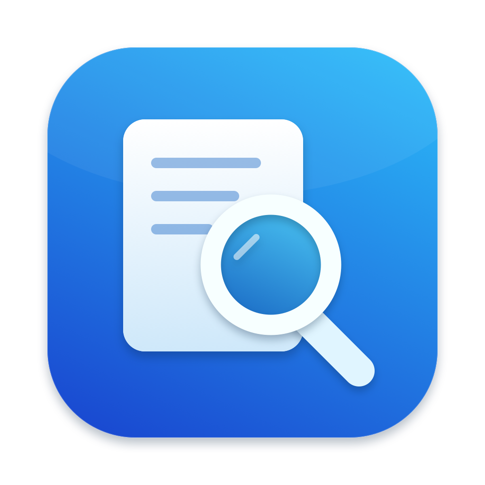

# Mac 工具系列图标

Mac Search 和 Mac Clean 使用同一套可复现的 AppKit 绘图语言，无外部图像服务依赖。

- 底板：1024 像素画布，824 像素圆角底板，圆角半径 186，透明留白与柔和阴影。
- 材质：白瓷主体、由左下到右上的彩色渐变、细描边及顶部柔光。
- Mac Search：蓝色底板，文件与放大镜，表达本地文件搜索。
- Mac Clean：青绿底板，扫刷与四角闪光，表达清理。
- 无文字或字母，避免小尺寸中出现难以辨认的信息。

## 预览




## 重新生成

在 Mac Search 仓库执行：

```bash
swift -module-cache-path .build/icon-module-cache scripts/generate_icon.swift Resources/AppIcon.png
swift -module-cache-path .build/icon-module-cache scripts/generate_icon.swift Resources/MacClean.png clean
bash scripts/build_app.sh
```

Mac Search 的应用打包脚本自动生成 16、32、128、256、512 像素的标准与 Retina 图标，并封装 ICNS。

Mac Clean 的 `Scripts/GenerateAppIcon.swift` 使用相同绘图代码，默认类型为 `clean`；运行该脚本后执行 `python3 Scripts/BuildAppIcon.py` 即可更新该项目的 PNG、iconset 与 ICNS。
